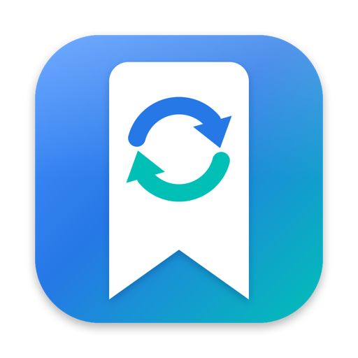

# BookmarkBridge



A macOS menu-bar app that keeps Safari and Chrome bookmarks identical. At setup you choose which browser's bookmarks are copied onto the other; from then on a change in either browser reaches the other within a few seconds.

## Build and run

```bash
./Scripts/bundle.sh
```

```bash
open /Applications/BookmarkBridge.app
```

The script installs the app to `/Applications` (set `INSTALL_DIR` to use another folder). Always run it from there: Full Disk Access, Launch at Login and Chrome's helper registration all point at the app's location.

The setup window walks through three steps: Full Disk Access (for Safari's bookmarks file), the Chrome helper extension, and the direction of the first copy. Requires macOS 14 or later.

## What syncs

| Safari | Chrome |
| --- | --- |
| Favorites | Bookmarks bar |
| Bookmarks Menu, plus other top-level folders and bookmarks | Other bookmarks |

Reading List and Chrome's Mobile bookmarks are not touched.

## How it decides

- Each sync compares both browsers with the state saved at the last sync, so it knows what was added, edited, moved or removed on each side.
- If both browsers changed the same bookmark, the browser whose change was seen most recently wins. An edit beats a delete.
- Before every write, both browsers' bookmarks are backed up to `~/Library/Application Support/BookmarkBridge/Backups` (the last 50 are kept). Restore from Backup in the menu puts each browser back.
- A sync that would remove more than 25 bookmarks, or more than 20 % of a browser's bookmarks if that is larger, stops and asks first.
- After writing, the app reads the browser back. If the change is not there, it stops instead of treating the missing bookmarks as deleted.

## Layout

- `Sources/SyncCore`: the browser-neutral model, three-way merge, diff and sync engine. A new browser is one more `BrowserAdapter`.
- `Sources/SafariAdapter`: reads and writes `~/Library/Safari/Bookmarks.plist`.
- `Sources/ChromeAdapter`, `Sources/bookmarkbridge-host`, `ChromeExtension`: Chrome's bookmarks through an extension and Chrome native messaging.
- `Sources/BookmarkBridge`: the menu-bar app.

```bash
swift test
```

```bash
node Tests/extension/background.test.js
```

## Known limits

- Writing Safari's bookmarks file while Safari is open, with iCloud bookmark sync on, is not documented by Apple. Whether Safari and iCloud keep such changes has to be checked on a real setup.
- The build signs with a self-signed certificate named "BookmarkBridge Local Signing" in the login keychain, so Full Disk Access survives rebuilds on this Mac. On a Mac without that certificate the build falls back to an ad-hoc signature, and Full Disk Access must be granted again after each rebuild.
- One Chrome profile: the one where the extension is loaded at setup. If another profile connects, or Chrome's main bookmark folders change (signing in or out of Chrome can do this), sync stops and says so.
- A bookmark Chrome refuses to store (for example a URL with no scheme) stops sync with a message naming it, until it is fixed or removed in Safari.

## A word of caution

This app rewrites your real bookmarks in two browsers. It backs both up before every write, but it is young software tested on one Mac. Export your bookmarks from both browsers before the first sync.

## License

MIT. See [LICENSE](LICENSE).
